# Profile recipes

Fifteen [unset.sh](https://unset.sh) profile recipes, with invented sample records, an interview guide, and desktop
and mobile mockups. Each has a different reading order and purpose within the same profile theme and card controls.

**Start with the [design review](DESIGN-REVIEW.md)** for research references, the changes to every recipe, repository
findings, and privacy-preserving media options. Run `npm run previews` and open `dist/index.html` for the local
browsable catalogue; it needs no server or external assets.

## Choose a recipe

Thumbnails below are **media studies**, including imagery the current app does not yet display. The Current and
Mobile links show the current-app approximation. These are layout mockups, not screenshots of a deployed profile.

| Media study | Recipe and purpose | Mockups |
| --- | --- | --- |
| 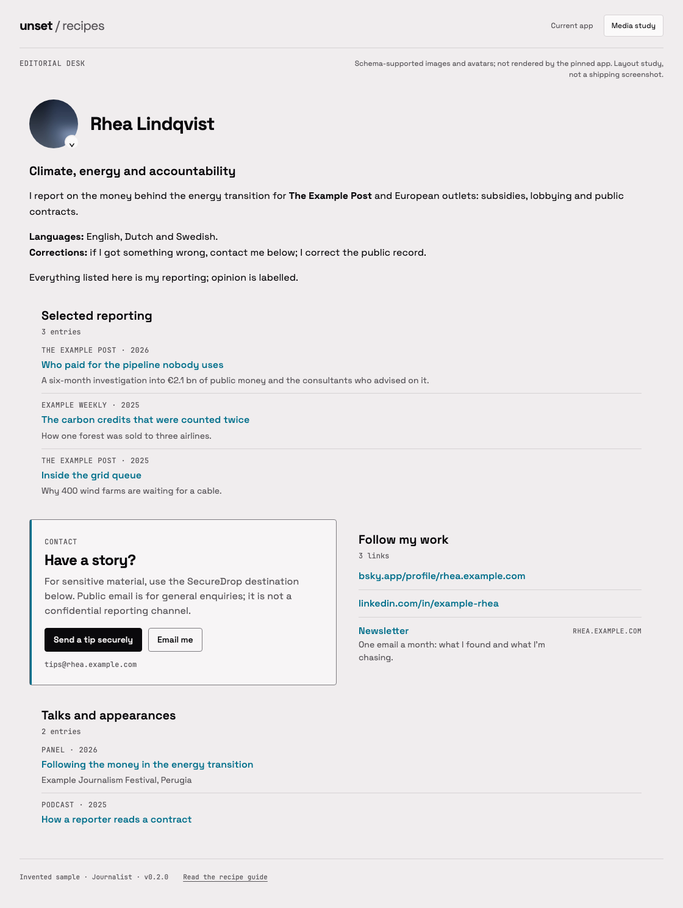 | **[Journalist](recipes/journalist/GUIDE.md)**<br>An editorial profile: introduce your beat, show three or four selected reports, then offer approved tip and follow destinations. | [Current](recipes/journalist/preview.png) · [Mobile](recipes/journalist/preview-mobile.png)<br>[Media study](recipes/journalist/preview-media.png) · [Media mobile](recipes/journalist/preview-media-mobile.png) |
| 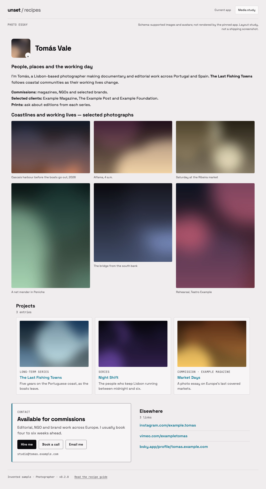 | **[Photographer](recipes/photographer/GUIDE.md)**<br>Introduce your photographic practice, present a coherent picture series and named projects, then explain how to commission you. | [Current](recipes/photographer/preview.png) · [Mobile](recipes/photographer/preview-mobile.png)<br>[Media study](recipes/photographer/preview-media.png) · [Media mobile](recipes/photographer/preview-media-mobile.png) |
| 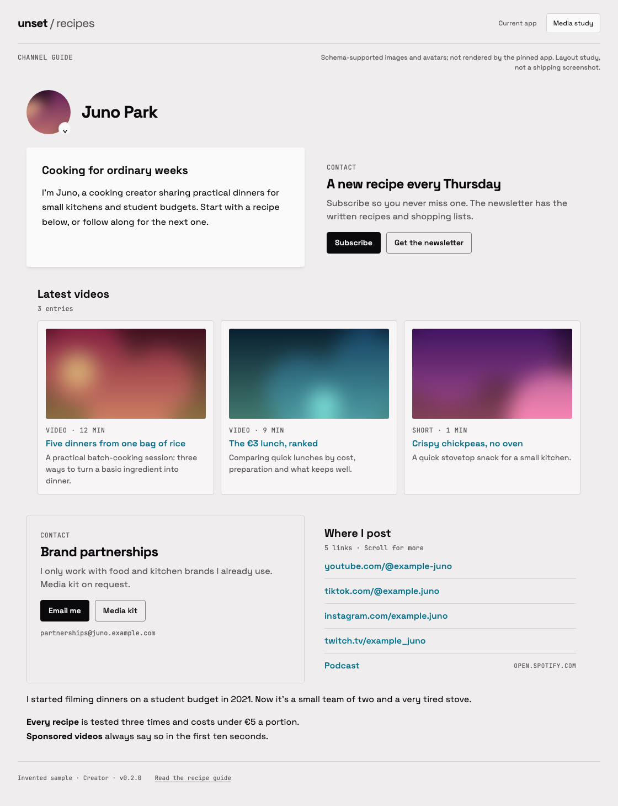 | **[Creator](recipes/creator/GUIDE.md)**<br>A channel hub: explain what you make, pair it with one subscribe action, and give selected work more room than platform links. | [Current](recipes/creator/preview.png) · [Mobile](recipes/creator/preview-mobile.png)<br>[Media study](recipes/creator/preview-media.png) · [Media mobile](recipes/creator/preview-media-mobile.png) |
| 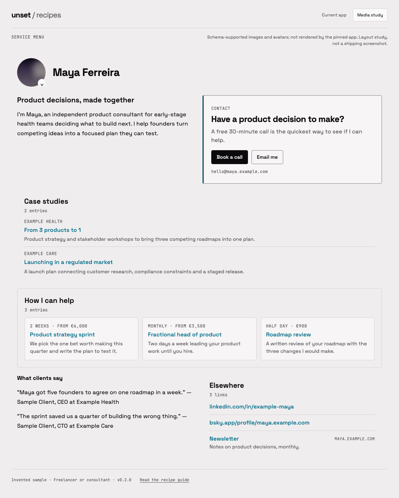 | **[Freelancer or consultant](recipes/freelancer/GUIDE.md)**<br>A focused service profile: who you help, selected case studies, comparable offers and a clear first conversation. | [Current](recipes/freelancer/preview.png) · [Mobile](recipes/freelancer/preview-mobile.png)<br>[Media study](recipes/freelancer/preview-media.png) · [Media mobile](recipes/freelancer/preview-media-mobile.png) |
| 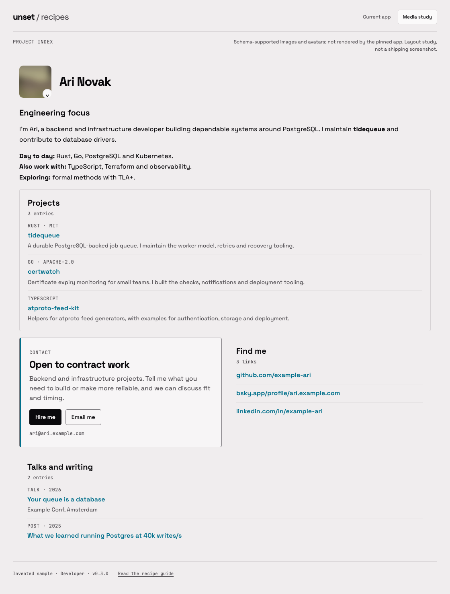 | **[Developer](recipes/developer/GUIDE.md)**<br>An engineering profile: explain your focus, show selected projects with your contribution, and connect code, writing and contact. | [Current](recipes/developer/preview.png) · [Mobile](recipes/developer/preview-mobile.png)<br>[Media study](recipes/developer/preview-media.png) · [Media mobile](recipes/developer/preview-media-mobile.png) |
| 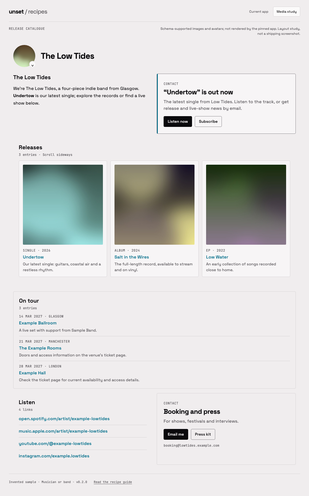 | **[Musician or band](recipes/musician/GUIDE.md)**<br>A release-led profile: introduce your sound, feature the current release, then separate the catalogue, live shows and industry enquiries. | [Current](recipes/musician/preview.png) · [Mobile](recipes/musician/preview-mobile.png)<br>[Media study](recipes/musician/preview-media.png) · [Media mobile](recipes/musician/preview-media-mobile.png) |
| 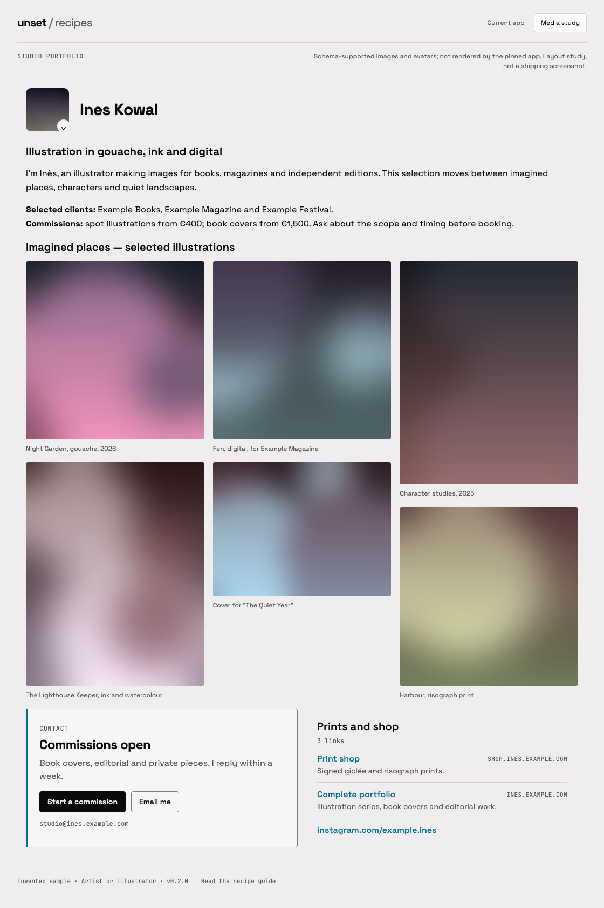 | **[Artist or illustrator](recipes/artist/GUIDE.md)**<br>A gallery profile: introduce your practice, give one body of work space, then separate commissions from editions and the full portfolio. | [Current](recipes/artist/preview.png) · [Mobile](recipes/artist/preview-mobile.png)<br>[Media study](recipes/artist/preview-media.png) · [Media mobile](recipes/artist/preview-media-mobile.png) |
| 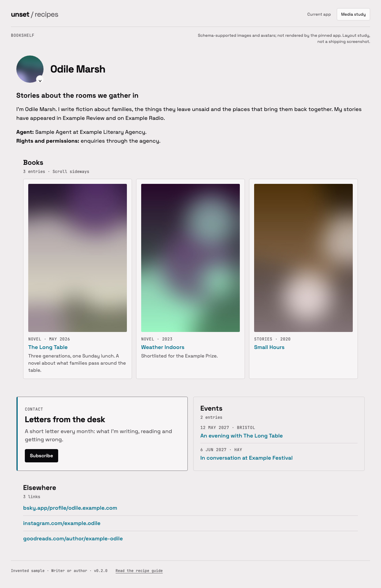 | **[Writer or author](recipes/writer/GUIDE.md)**<br>An author profile with a clear writing voice, a short publication shelf, an ongoing newsletter and confirmed events. | [Current](recipes/writer/preview.png) · [Mobile](recipes/writer/preview-mobile.png)<br>[Media study](recipes/writer/preview-media.png) · [Media mobile](recipes/writer/preview-media-mobile.png) |
| 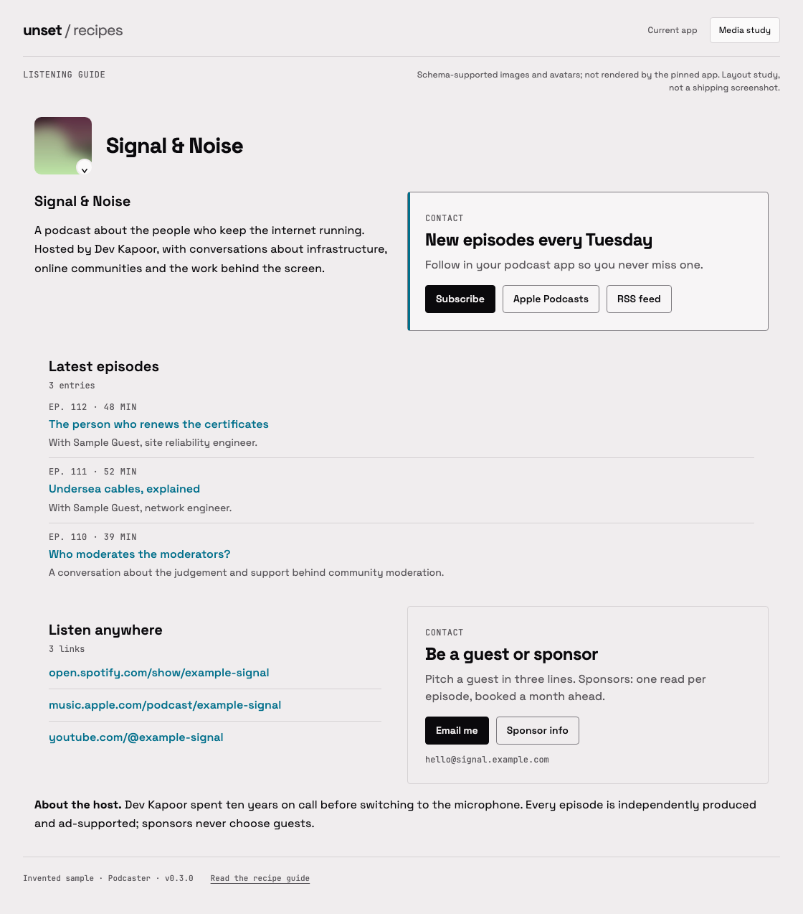 | **[Podcaster](recipes/podcaster/GUIDE.md)**<br>A listening hub: explain the show, make following easy, and separate selected episodes from guest and sponsor enquiries. | [Current](recipes/podcaster/preview.png) · [Mobile](recipes/podcaster/preview-mobile.png)<br>[Media study](recipes/podcaster/preview-media.png) · [Media mobile](recipes/podcaster/preview-media-mobile.png) |
| 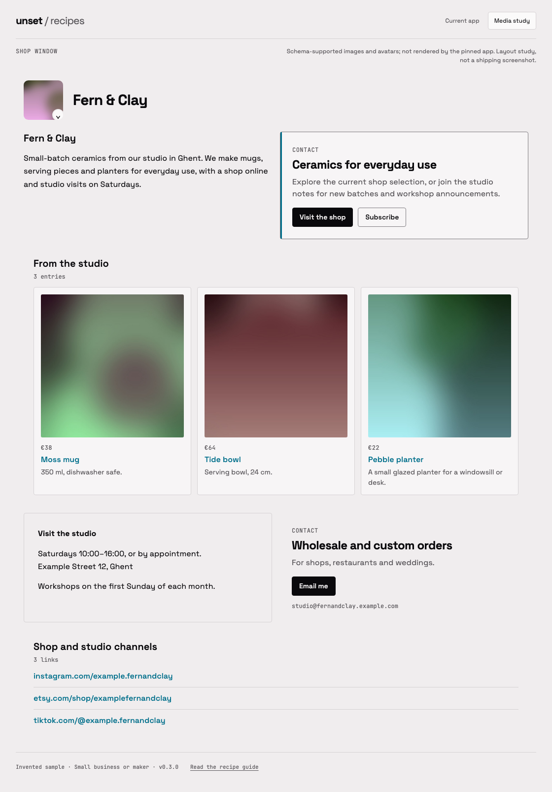 | **[Small business or maker](recipes/small-business/GUIDE.md)**<br>A practical storefront: explain what you offer, make shopping easy, then show products, visit details and custom enquiries. | [Current](recipes/small-business/preview.png) · [Mobile](recipes/small-business/preview-mobile.png)<br>[Media study](recipes/small-business/preview-media.png) · [Media mobile](recipes/small-business/preview-media-mobile.png) |
| 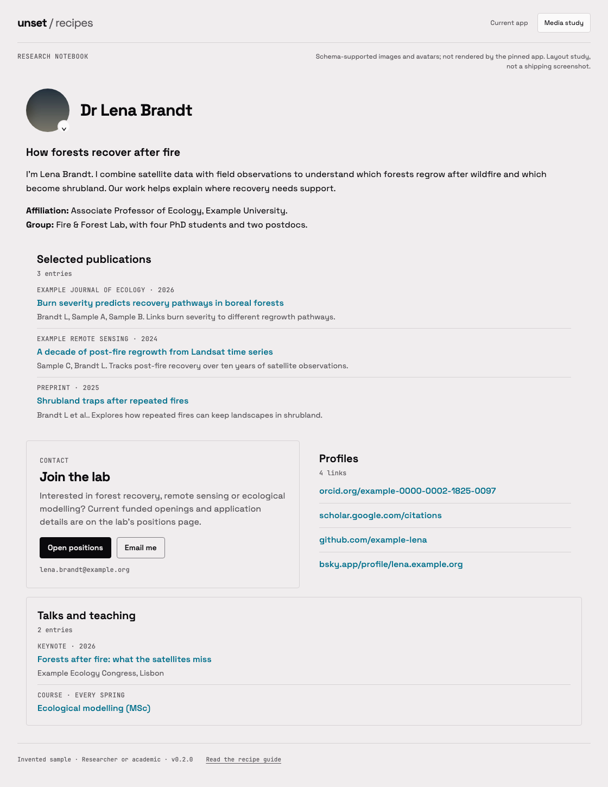 | **[Researcher or academic](recipes/researcher/GUIDE.md)**<br>A compact research index: explain the question, show selected publications with context, and link to the complete scholarly record. | [Current](recipes/researcher/preview.png) · [Mobile](recipes/researcher/preview-mobile.png)<br>[Media study](recipes/researcher/preview-media.png) · [Media mobile](recipes/researcher/preview-media-mobile.png) |
| 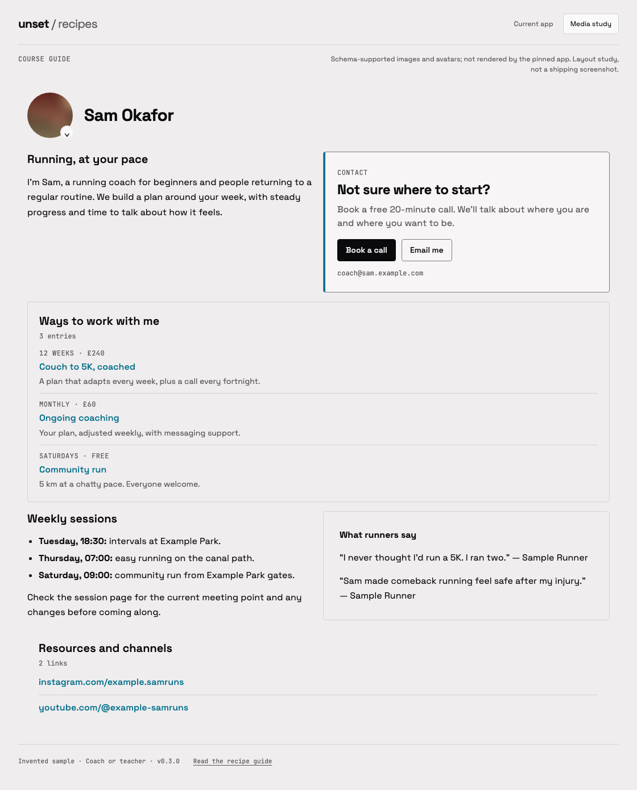 | **[Coach or teacher](recipes/coach/GUIDE.md)**<br>A clear coaching offer: who it helps, how to start, what each format includes, and when recurring sessions take place. | [Current](recipes/coach/preview.png) · [Mobile](recipes/coach/preview-mobile.png)<br>[Media study](recipes/coach/preview-media.png) · [Media mobile](recipes/coach/preview-media-mobile.png) |
| 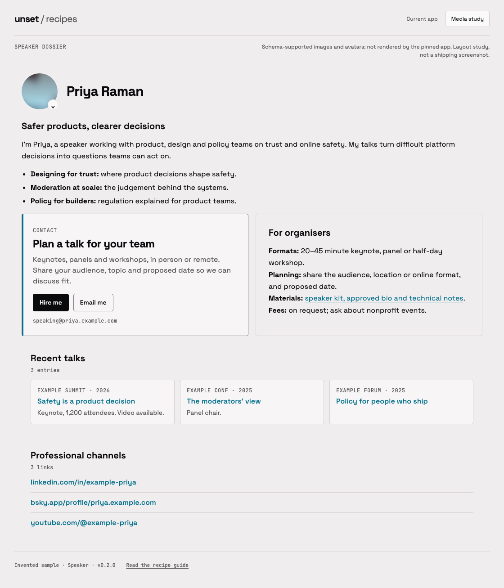 | **[Speaker](recipes/speaker/GUIDE.md)**<br>An organizer-focused profile: establish topics and audience fit, offer an enquiry route, then support it with practical details and recordings. | [Current](recipes/speaker/preview.png) · [Mobile](recipes/speaker/preview-mobile.png)<br>[Media study](recipes/speaker/preview-media.png) · [Media mobile](recipes/speaker/preview-media-mobile.png) |
| 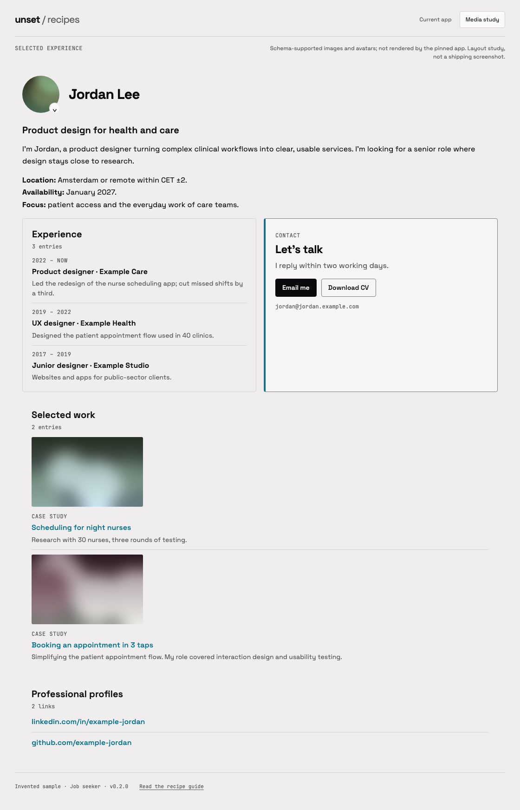 | **[Job seeker](recipes/job-seeker/GUIDE.md)**<br>A compact résumé: state the role you want, pair relevant experience with contact, and support it with public work. | [Current](recipes/job-seeker/preview.png) · [Mobile](recipes/job-seeker/preview-mobile.png)<br>[Media study](recipes/job-seeker/preview-media.png) · [Media mobile](recipes/job-seeker/preview-media-mobile.png) |
| 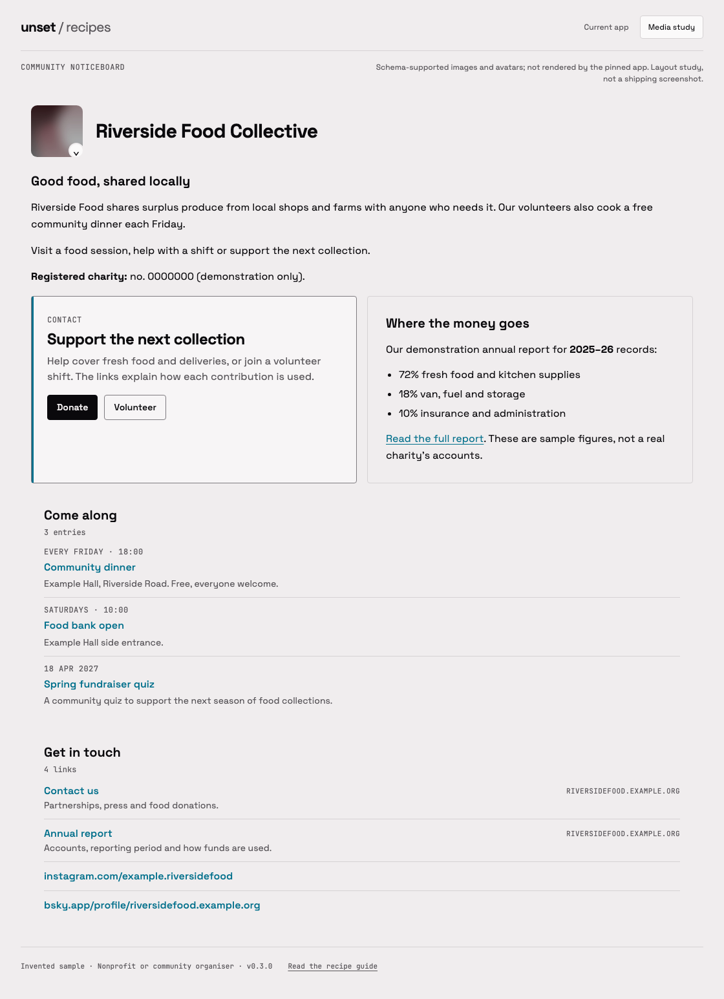 | **[Nonprofit or community organiser](recipes/nonprofit/GUIDE.md)**<br>A mission-led community profile: explain who you serve, pair participation with transparent evidence, and list useful activities. | [Current](recipes/nonprofit/preview.png) · [Mobile](recipes/nonprofit/preview-mobile.png)<br>[Media study](recipes/nonprofit/preview-media.png) · [Media mobile](recipes/nonprofit/preview-media-mobile.png) |

All names, claims, links and images are invented samples. The existing abstract pictures are placeholders, not the
people or work described. Applying a recipe means replacing or dropping every sample detail, never publishing it.

## Use a recipe

**With an AI assistant.** Point it at this repository and say who you are, for example:

> Using github.com/unset-sh/profile-recipes, help me set up my unset.sh profile. I'm a freelance photographer.

The assistant follows [AGENTS.md](AGENTS.md), chooses a recipe, asks its questions and prepares card text. It never
asks for passwords or publishes on your behalf. **By hand:** read the guide, use the current-app mockup as the layout
reference, and enter supported cards in the editor. Keep media slots for when the app supports them.

## Current app and media studies

Support was inspected at app commit
[`0dd0795`](https://github.com/Undefined6799/unset/tree/0dd079517074917ebd5217f7ecf15f4984cdd5d3), not inferred from
schema validation. This is a dated snapshot; check upstream before applying it to a later release.

| Capability | Current-app mockup | Media study |
| --- | --- | --- |
| Text, links, showcase entries, action buttons | Shown | Shown |
| Full/half width; filled/outlined/plain surface | Shown; halves stack on mobile | Same controls |
| List/grid/carousel for links and showcases | Shown | Shown |
| Profile header | Name + initial; avatar control opens About | Name + sample avatar; same About control |
| Headline, place, website | In About, not under the name | In About |
| Image blocks and showcase pictures | Omitted, as in the pinned renderer | Illustrated from local sample assets |
| Embedded players, remote thumbnails, custom colors/fonts | None | None |

The app's schema already describes images, but its inspected public route supplies no avatar and its card view
exposes only the four text/link/action kinds. Every recipe's first visible card therefore identifies the person or
organization without relying on imagery or a visible headline. Media studies preserve the original proportions of
cover art and gallery pictures; their composition is a proposal for pending image display, not an extra stored
layout option. The public page remains useful without those pictures.

The static preview is deliberately approximate: app navigation, verified handle/DID, owner controls, the About
contact shortcut and the full Markdown renderer are not reproduced. The samples use an escaped Markdown subset
(headings, paragraphs, bold, HTTPS/HTTP links, bullet lists and blockquotes). The app remains the rendering authority. Review chrome
and catalogue styles are not profile settings.

## What is stored here

```
recipes/<id>/
├── recipe.json             audience, card order, questions and writing guidance
├── GUIDE.md                layout, interview, references and publishing checklist
├── profile.json            example sh.unset.profile record
├── cards/                  example sh.unset.card records
├── assets/                 abstract sample JPEGs referenced by CID (CC0)
├── preview.png             desktop, current-app approximation
├── preview-mobile.png      mobile, current-app approximation
├── preview-media.png       desktop media study
└── preview-media-mobile.png mobile media study
schemas/upstream/           exact copied upstream Lexicon definitions, provenance and license
```

`schemas/upstream/` contains **actual vendored schemas, not example Lexicons**. They define `sh.unset.profile`,
`sh.unset.card`, and the `sh.unset.block.*` types. The sample *records* live under `recipes/`. Definitions and
publication belong to the upstream AT Protocol authority; this repository does not publish or redefine them.
The [source manifest](schemas/upstream/source.json) records the full commit. Never rename an NSID to describe an
example, or change a copied schema to make a recipe pass.

Each slot points at a record field using [JSON Pointer](https://www.rfc-editor.org/rfc/rfc6901). A profile template
omits `cards` until records exist; a preparing tool later builds `{ "uri": "at://<did>/sh.unset.card/<rkey>" }`
references in manifest order. Only the owner's own card addresses belong there. This does not authorize automatic
publishing. Profile visibility preferences are not network access control: repository records remain public.

## Checks and previews

Use Node **26.12.0**, as pinned in `.nvmrc`.

```sh
npm ci --ignore-scripts
npx playwright install chromium --only-shell
npm run check      # typecheck, tests, validate all fifteen recipes
npm run previews   # build dist/, capture all sixty PNGs, then refresh catalogue thumbnails
```

The checks verify schema fields and supported block types, editor limits, sample URLs, CID/file matches, JPEG
metadata and dimensions, manifest/card/slot references, and guide sections. Unknown fields are rejected as a
**template quality rule**, not a claim that upstream forbids extensions. Text uses the editor's 10,000-byte UTF-8
cap; schema ceilings can be higher. [limits.json](limits.json) separates editor limits from repository sample policy.

The preview pass checks local image decoding, no horizontal page overflow at desktop/mobile and 320px dark mode,
no third-party HTTP requests, and keyboard opening/closing of About. It saves desktop at 1120px and mobile at 390px,
plus `dist/overview.png`. These checks cover the preview tool, not end-to-end live app behavior or a full accessibility
audit. `npm run render` can rebuild HTML alone from committed previews; there are no runtime dependencies in the
output, no JavaScript, analytics, provider frames or external fonts.

## Dependencies

Development tools remain pinned: `@atproto/lexicon` 0.7.21, `multiformats` 14.0.6, `playwright` 1.63.0,
`typescript` 7.0.2 and `@types/node` 22.20.5. Version-specific API references used by the tooling are
`node_modules/@atproto/lexicon/dist/lexicons.js`, `dist/validators/`, and
`node_modules/playwright-core/types/types.d.ts`.

The November 21, 2026 online npm audit reports **three high-severity package entries for one transitive Zod advisory**,
[GHSA-mrhx-c7xc-m3w5](https://github.com/advisories/GHSA-mrhx-c7xc-m3w5), through `@atproto/lexicon` and
`@atproto/common-web`; npm reports no compatible fix. This remains an existing development-dependency issue, not a
newly resolved vulnerability or a runtime dependency of the static pages. See the review notes before changing pins.

## Status and license

Draft **0.2** migrates every recipe from the old `sh.unset.section` format to the current card/block contract. It is
not compatible with consumers expecting the old records. The upstream publication lock is empty at the pinned
commit; the schema snapshot is not evidence of network publication or complete editor support.

Recipes under `recipes/` are [CC0 1.0](LICENSE-CONTENT). Tooling is [MIT](LICENSE). Copied schemas carry their
[upstream MIT notice](schemas/upstream/LICENSE). Local fonts retain their SIL Open Font License files in `site/fonts/`.
