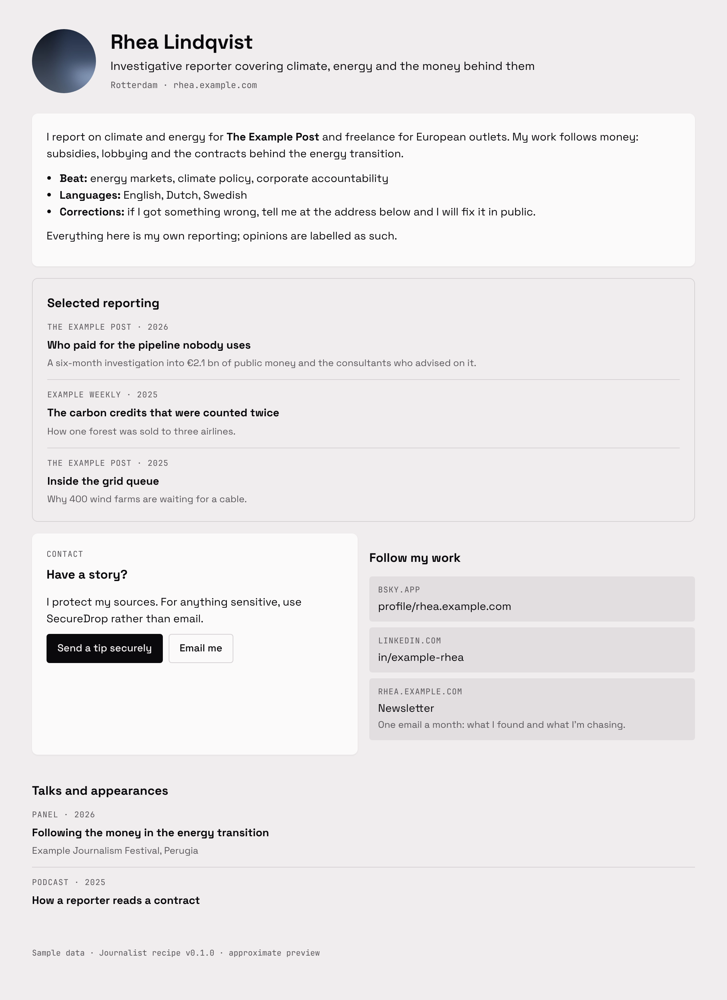
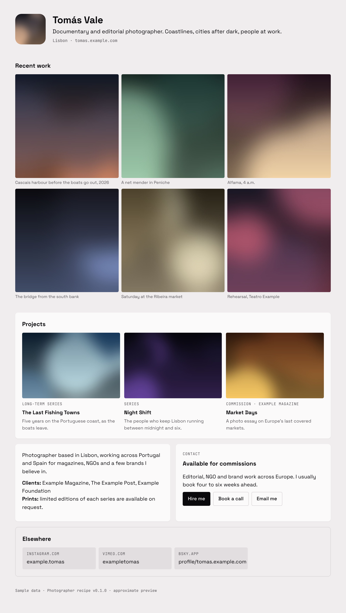
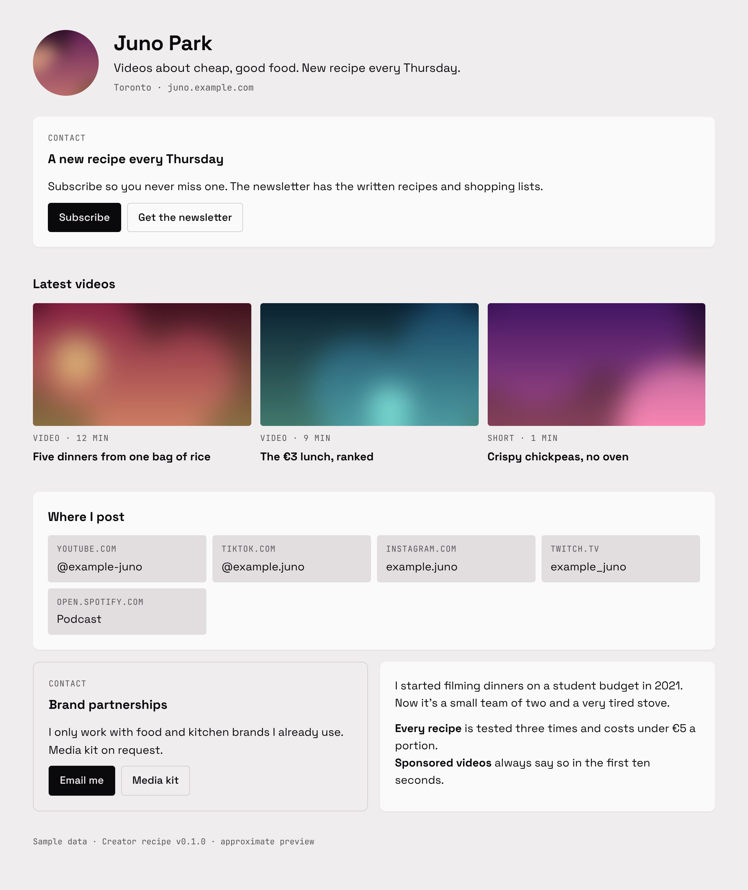

# Profile recipes

Ready-made [unset.sh](https://unset.sh) profile layouts for different kinds of people, each with a guide an AI
assistant can follow to build one for you.

| | Recipe | Built for |
| --- | --- | --- |
|  | **[Journalist](recipes/journalist/GUIDE.md)** | Reporters and editors: your beat up front, your best work as a list, and a safe way for sources to reach you. |
|  | **[Photographer](recipes/photographer/GUIDE.md)** | Pictures first: a full-width gallery, projects as a grid, then a short bio and a clear way to hire you. |
|  | **[Creator](recipes/creator/GUIDE.md)** | Creators and influencers: one clear subscribe action, latest work, every platform in one place, a door for brands. |

All names, links and pictures in the recipes are invented samples.

## Use a recipe

**With an AI assistant.** Point it at this repository and say who you are, for example:

> Using github.com/unset-sh/profile-recipes, help me set up my unset.sh profile. I'm a freelance photographer.

The assistant reads [AGENTS.md](AGENTS.md), picks the closest recipe, asks you the questions in its guide, and hands
you finished text for each card, in order. It never asks for your password and never publishes anything for you.

**By hand.** Open a recipe's `GUIDE.md`, look at its preview, and add the same cards in the unset.sh profile editor.

## What a recipe is

```
recipes/<id>/
├── recipe.json     who it is for, the card order, and the questions to ask (slots)
├── GUIDE.md        the layout and why, the interview, writing rules, a pre-publish checklist
├── profile.json    a sample sh.unset.profile record
├── cards/          one sample sh.unset.section record per card, in page order
├── assets/         sample pictures the records refer to (generated, CC0)
└── preview.png     a rendering of the sample
```

The records are real atproto records in the exact shape unset.sh stores in your repository: the
[`sh.unset.profile`](lexicons/sh.unset.profile.json) and [`sh.unset.section`](lexicons/sh.unset.section.json)
lexicons, copied from the app at the commit in [`lexicons/source.json`](lexicons/source.json). A recipe is
therefore never a mock-up of something the app cannot show.

Each **slot** in `recipe.json` points at a field with a [JSON Pointer](https://www.rfc-editor.org/rfc/rfc6901)
and says what to ask the member, how to write the answer, and what to do if they have none (drop the field, the
item or the whole card).

## Checks

Every pull request runs `npm run check`:

- each record is valid against the lexicons, with no fields they do not define (the app refuses those on save);
- each record fits the editor's own limits, which are stricter than the lexicon's ([`limits.json`](limits.json));
- every picture reference matches a file in `assets/` by CID, is a JPEG under 2 MB and 2560 px, with no metadata;
- sample links and emails point only at example domains, never at a real person;
- every card file is listed, every slot points at a field that exists, and `GUIDE.md` has its required sections.

```sh
npm ci
npm run check      # typecheck, tests, validate every recipe
npm run previews   # render dist/ and regenerate each preview.png (needs Playwright's Chromium)
```

## Dependencies

All are development tools, pinned exactly in `package.json`:

- `@atproto/lexicon` 0.7.21 validates records against the lexicons (`Lexicons.assertValidRecord`). `npm audit`
  reports GHSA-mrhx-c7xc-m3w5 in its `zod` 3 dependency: memory exhaustion from an oversized array. It has no fixed
  zod 3 release, and here it reads only recipe files that go through review, so it is accepted, as in the app.
- `multiformats` 14.0.6 computes picture CIDs to match blob references to files.
- `playwright` 1.63.0 takes the preview screenshots; `typescript` 7.0.2 and `@types/node` check the scripts.

## Status

Draft, version 0.x. The card lexicon (`sh.unset.section`) is not yet published by unset.sh and may still change;
recipes move to 1.0 once it is. The previews approximate the app's look; the app is the real renderer.

## Licence

Recipes (everything under `recipes/`) are dedicated to the public domain under [CC0 1.0](LICENSE-CONTENT): copy
them into your profile with no attribution. Tooling is [MIT](LICENSE). Fonts in `site/fonts/` are under the SIL Open
Font License, with their licence files beside them.
