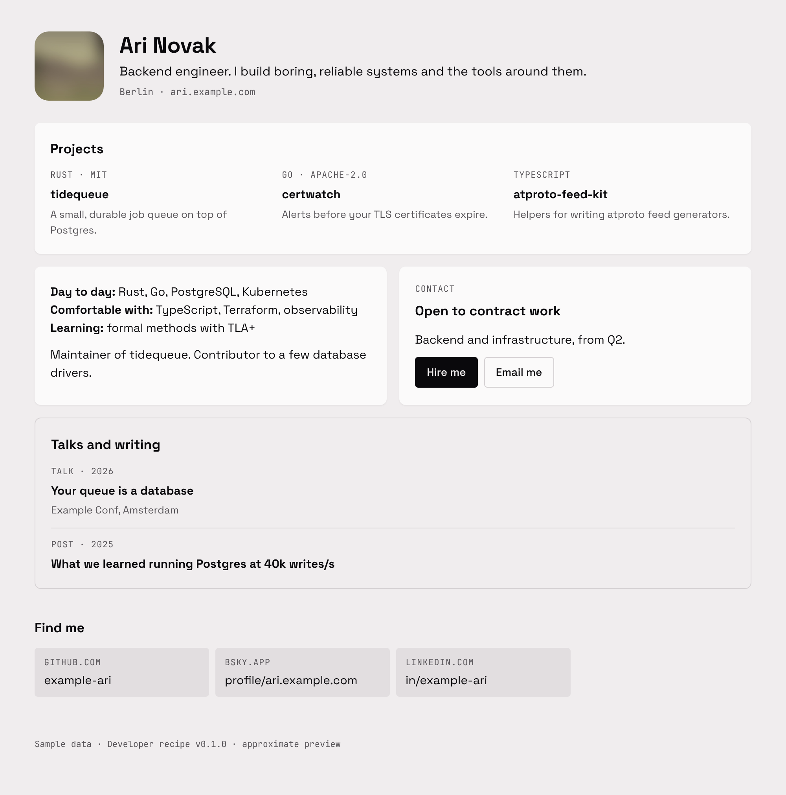

The developer recipe explains an engineering practice, shows selected projects and offers contact destinations.
All people, projects and claims in this example are invented demonstration content.



This is the repository's desktop **current-app approximation**, not a deployed profile. It reflects the support review
at app commit `0dd0795`; navigation, the full Markdown renderer and owner controls are outside the mockup.

## 1. Read the order

The [manifest](https://github.com/unset-sh/profile-recipes/blob/main/recipes/developer/recipe.json) lists:

1. Engineering focus — text, full width, plain surface.
2. Projects — showcase list, full width, outlined surface.
3. Open to contract work — optional buttons, half width, filled surface.
4. Find me — links list, half width, plain surface.
5. Talks and writing — optional showcase list, full width, plain surface.

This is also the interview and reading order. If the person omits the contract-work action, widen “Find me” to fill
the row. On small screens, the retained cards stack in this same order.

## 2. Inspect the first card

The first file is `cards/02-stack.json`. Here is the complete sample record:

```json
{
  "$type": "sh.unset.card",
  "content": {
    "$type": "sh.unset.block.text",
    "text": "## Engineering focus\n\nI’m Ari, a backend and infrastructure developer building dependable systems around PostgreSQL. I maintain **tidequeue** and contribute to database drivers.\n\n**Day to day:** Rust, Go, PostgreSQL and Kubernetes.\n**Also work with:** TypeScript, Terraform and observability.\n**Exploring:** formal methods with TLA+."
  },
  "width": "full",
  "createdAt": "2026-01-01T00:00:00.000Z",
  "surface": "plain"
}
```

`$type` identifies the card record. `content.$type` identifies the text block inside it. Width and surface describe
the card's layout; `content.text` holds the Markdown. The timestamp and all the text are sample data.

## 3. Connect the question to its field

The `stack` slot points to `cards/02-stack.json` and `/content/text`. It asks about the person's engineering work,
audience, current contribution and tools. Its writing rule calls for a short heading, two sentences and a few labelled
lines. It forbids unsupported maintainer claims and skill ratings.

Replace the whole sample text with the person's answers. If they do not answer this required question after a follow-up,
omit the card. Do not turn “Ari maintains tidequeue” into a claim about the person.

## 4. Check your understanding

- Moving a card changes manifest order; renaming its file is not required.
- A missing optional answer follows that slot's `ifEmpty` rule.
- Passing validation proves the sample follows the pinned contract and repository policy, not that every field is rendered.
- The person reviews and enters the result; this exercise does not publish records.

Compare the [full guide](https://github.com/unset-sh/profile-recipes/blob/main/recipes/developer/GUIDE.md) and
[source card](https://github.com/unset-sh/profile-recipes/blob/main/recipes/developer/cards/02-stack.json), or continue to
[the architecture boundaries](../understand-a-recipe.md). The record and preview are CC0-1.0; this explanation is AGPL-3.0-only.
